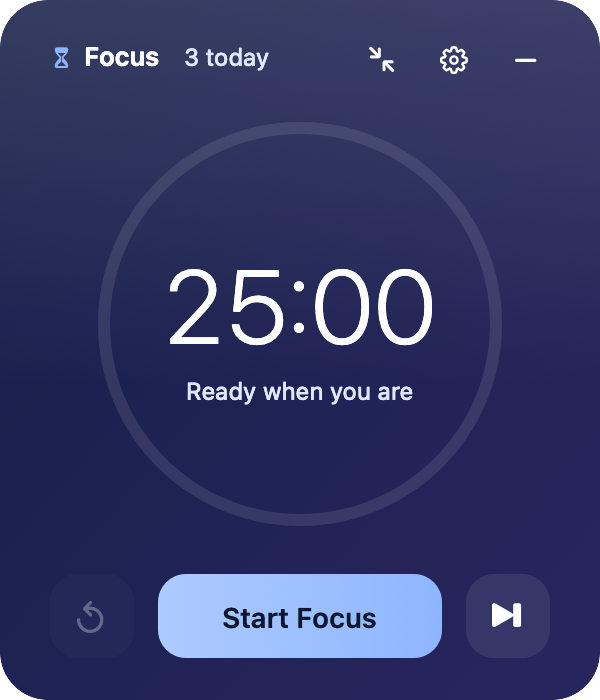
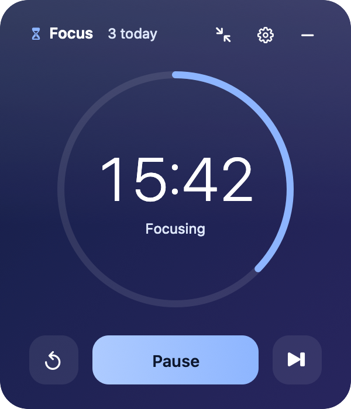
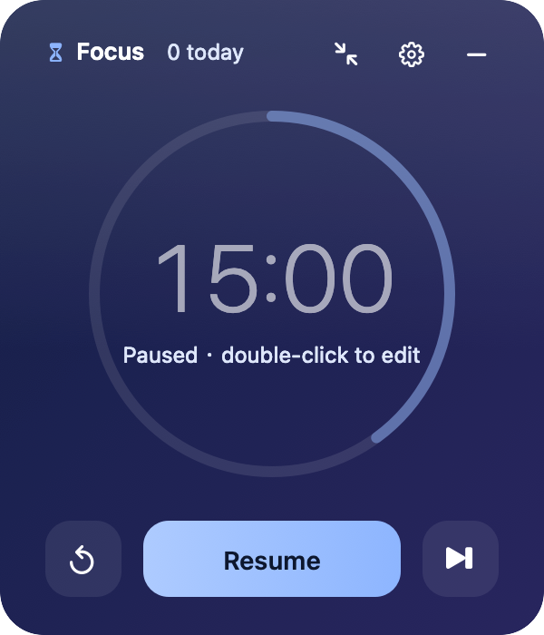
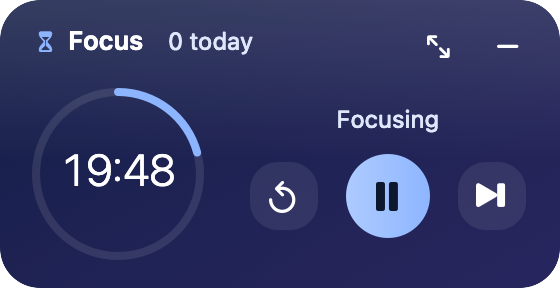
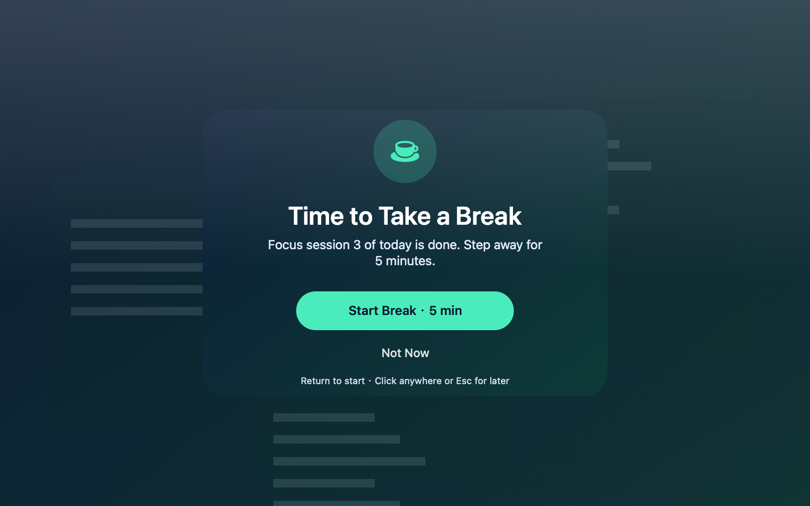
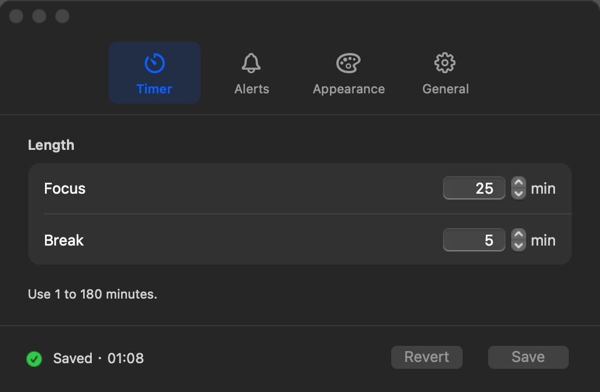
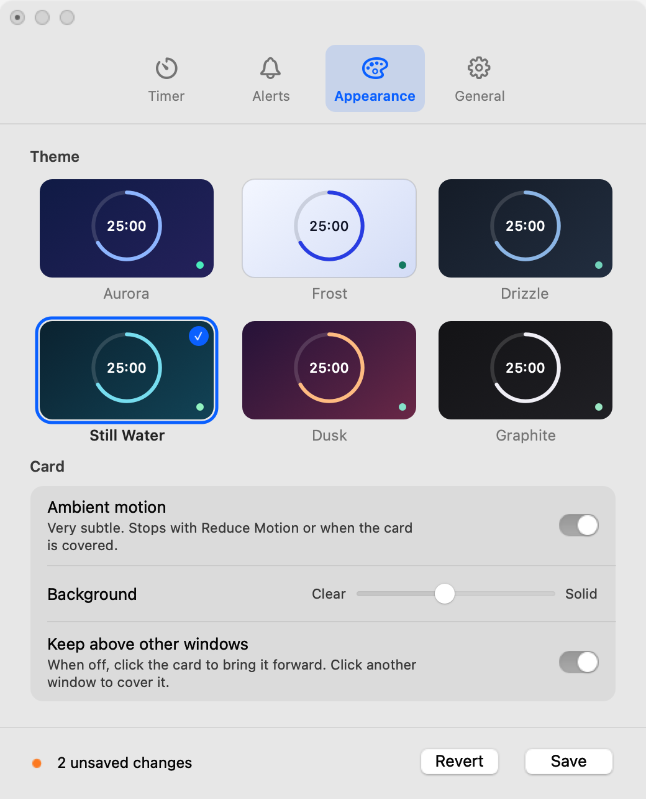

# FocusCard · 专注卡片

[English](README.md) | [简体中文](README.zh-CN.md)

FocusCard is a focus and break timer for macOS.
It shows a translucent card and a countdown in the menu bar.
The app uses Objective-C and AppKit.
The interface uses Simplified Chinese or English. The app follows the macOS language setting.

<p align="center">
  
</p>

## Screenshots

The app renders these reference images from its native views.
The prompt image uses a sample desktop.

| Ready | Focus | Paused | Compact |
| --- | --- | --- | --- |
|  |  |  |  |



<details>
<summary>Themes and Settings</summary>

| Aurora | Frost | Drizzle | Still Water | Dusk | Graphite |
| --- | --- | --- | --- | --- | --- |
|  |  |  |  |  |  |




</details>

## Features

- A progress ring shows the elapsed part of the current phase.
- Switch between the full card and a compact card (280 × 144 pt, landscape) with one click.
- Start, pause, resume, reset or skip a phase from the card, the menu bar or the keyboard.
- Set focus and break lengths from 1 to 180 minutes.
- Select automatic starts between focus and break (with the "Notification only" prompt style).
- When a phase ends, a full-screen frosted prompt appears on every screen.
  The prompt says "Time to Take a Break" or "Ready to Focus?". The next phase starts only when you select the main button or press Return. Press Esc, or click anywhere else, to keep the next phase ready for later.
- Select a completion sound from seven macOS sounds, or None. Select ▶ to hear it.
- Select one of six themes: Aurora, Frost, Drizzle, Still Water, Dusk and Graphite. Each theme has a subtle ambient motion: slow light, light rain ripples, water ripples or a glint on frosted glass. Graphite has no motion.
- When the timer is paused, double-click the time to change the length.
- Select the language: System, 简体中文 or English.
- See the number of focus sessions that you completed today next to the phase name.
- Show the countdown in the menu bar while a timer runs.
- Keep the card above other windows, or let other windows cover it.
- Adjust the card background.
- Open the app automatically at login.
- The app restores the timer and the card position when it opens again.

Default values:

| Setting | Default |
| --- | --- |
| Focus length | 25 minutes |
| Break length | 5 minutes |
| Prompt when a phase ends | Full-screen prompt |
| Sound | Glass |
| Notification | On |
| Theme | Aurora, ambient motion on |
| Language | System |
| Start break / focus automatically (notification only style) | On / Off |
| Keep above other windows | Off |
| Show time left in the menu bar | On |

## Requirements

- macOS 13 or later.
- Xcode Command Line Tools supply the compiler.
- The build uses the native architecture of the Mac.

The app has no external dependencies.
The app does not use the network.

## Download

[Download version 3.1.1](https://github.com/hzxwonder/focus-card-macos/releases/tag/v3.1.1).
Select the archive for Apple Silicon (`arm64`).
Extract the archive.
Move `FocusCard.app` to Applications.
Open the app.

The release uses an ad hoc signature.
It does not include Apple notarization.
The release is public.

## Build

1. Install Xcode Command Line Tools if necessary.

   ```sh
   xcode-select --install
   ```

2. Clone this repository and go to its directory.

   ```sh
   git clone https://github.com/hzxwonder/focus-card-macos.git
   cd focus-card-macos
   ```

3. Build the app.

   ```sh
   bash scripts/build.sh
   ```

4. Open the app.

   ```sh
   open build/FocusCard.app
   ```

The build script compiles the app, runs the self-test in Chinese and in English, makes the icon and applies an ad hoc signature.
The build stops if a test fails.
The build does not notarize the app.
To open the app on a different Mac, notarize it or allow it in **System Settings › Privacy & Security**.

## Use

### Card

| Control | Action |
| --- | --- |
| Primary button | Start, pause or resume the timer. |
| Time (paused) | Double-click to open Settings at the length of the current phase. |
| Reset (↺) | Restore the full length of the current phase. The button is available after the timer starts. |
| Skip (⏭) | Go to the next phase. A skipped phase does not count as a session. |
| Settings (⚙) | Open Settings. |
| Compact (↘↖) | Switch to the compact card. In the compact card, the same button (↖↘) restores the full card. |
| Hide (–) | Hide the card. The timer continues. |
| Card background | Drag to move the card. |

The header shows the phase and the number of focus sessions that you completed today.
The compact card is a landscape strip. It shows the phase, today's sessions, the ring with the time, the state, and the Reset, Start/Pause and Skip buttons.
Open Settings from the menu bar or with Command-Comma when the card is compact.
The card keeps its mode when the app opens again.

### Menu bar

The menu bar shows an hourglass during focus and a cup during a break.
When a timer runs, the menu bar also shows the time that remains.
When the timer is paused, a pause icon replaces the phase icon.
All icons in the app use SF Symbols with one weight, so they match the system and adapt to light and dark menu bars.
Click the icon to open the menu.
The menu shows the state, today's sessions, the timer commands and the **Compact Card** option.

### Keyboard

| Keys | Action |
| --- | --- |
| Space | Start or pause the timer when the card is active. |
| Command-R | Reset the current phase. |
| Command-Right Arrow | Skip to the next phase. |
| Command-W | Hide the card, or close Settings. |
| Command-Comma | Open Settings. |
| Command-Q | Quit the app. |
| Return (prompt) | Start the next phase. |
| Esc or a click outside the buttons (prompt) | Close the prompt. The next phase stays ready. |

### Settings

Settings has four panes: Timer, Alerts, Appearance and General.
Changes are a draft until you select **Save** (or press Return).

- The bar at the bottom shows the state: all saved, the number of unsaved changes, or "Saved" with the time.
- Theme, background and ambient motion show a live preview on the card before you save.
- **Revert** discards the draft. If you close Settings with unsaved changes, Settings asks: Save, Don't Save or Cancel.
- If the timer did not start, a new length applies to the current phase.
- If the timer is paused, a new length applies to the current phase. The app keeps the time already used. If the new length is shorter than the time used, the time shows 00:00 and Resume completes the phase.
- If the timer runs, a new length applies to the next phase.
- Enter a whole number from 1 to 180.
  For invalid input, the app disables Save and shows a red message.
- **Restore Defaults** puts the default values in the draft. Select Save to apply them. It does not change the timer or today's sessions.
- A new language applies after the app opens again. Select **Relaunch Now**. The timer continues.

## Notifications

1. Start a timer, or select **Allow Notifications…** in Settings.
2. Allow notifications when macOS asks.
3. Select **Send Test Notification** in Settings to examine the delivery.

If macOS blocks notifications, the Settings button opens the macOS notification settings.
macOS Focus modes can stop notification banners.
The sound uses the output volume of the Mac.

## Timer behavior

- When you start the timer, the app stores the end time.
- When you pause the timer, the app stores the time that remains.
- Sleep time counts toward the current phase.
- When a phase ends while the Mac sleeps or the app is closed, the app completes the phase once. If the phase ended more than one minute before, the app does not play an alert and does not start the next phase automatically. The card shows the end time.
- If the system clock moves back, the remaining time cannot be more than the phase length.
- Today's session count starts again at midnight.

## Privacy

- The app keeps all data in local preferences on your Mac (`defaults read local.focuscard.desktop`).
- The app does not send data to a server and does not use analytics.
- The app stores only timer state, settings, today's session count and the card position.
- Notifications contain only the phase name and length.
- The ambient motion stops when the card is hidden or covered, and when **Reduce Motion** is on in macOS.

## Checks

Run the complete test command on macOS:

```sh
bash scripts/test.sh
```

This command builds the app and renders the reference images.
It runs 185 self-tests in each language.
It runs the live UI tests in Chinese and English.
The UI tests use a separate app identifier and preferences domain.
The tests open windows and prompts on the current desktop.
JSON results and logs appear in `build/test-results/`.
A blocked check does not count as a pass.

The current run passed 487 checks, with no failed checks.
Five entries need manual checks for window drag or foreground keyboard focus.
See [the validation report](docs/TESTING.md) for results, performance measurements, and test limits.

You can run the self-tests directly:

```sh
FOCUSCARD_LANG=zh build/FocusCard.app/Contents/MacOS/FocusCard --self-test
FOCUSCARD_LANG=en build/FocusCard.app/Contents/MacOS/FocusCard --self-test
```

Other commands:

```sh
# Render reference images from the native views
build/FocusCard.app/Contents/MacOS/FocusCard --render-screenshots /tmp/focuscard-shots
# Read notification permission and delivered notifications
build/FocusCard.app/Contents/MacOS/FocusCard --notification-status
```

## Package

Commit the source changes before you create a package.

```sh
bash scripts/package.sh
```

The script builds the app and creates an archive in `build/release/`.
It extracts the archive and checks the signature and executable bytes.
It runs both language self-tests on the extracted app.
It also writes build information and SHA-256 checksums.

## Files

| Path | Content |
| --- | --- |
| `src/FocusCard.m` | App, timer model, settings, notifications, self-test and screenshot rendering. |
| `resources/Info.plist` | App bundle information. |
| `scripts/build.sh` | Build script. Use `--screenshots` to render images to `build/screenshots`. |
| `scripts/test.sh` | Isolated UI tests in both languages. |
| `scripts/package.sh` | Archive creation and integrity checks. |
| `assets/icon.svg` | Editable hourglass icon. |
| `assets/icon.png` | Icon at 1024 × 1024 pixels. |
| `docs/screenshots/` | App screenshots. |
| `build/` | Local build output. Git ignores this directory. |

## Documentation style

The English instructions follow ASD-STE100 writing principles: short sentences, active voice and consistent terms.
This project does not claim full ASD-STE100 dictionary compliance or certification.

## License

This project is licensed under the [MIT License](LICENSE).
