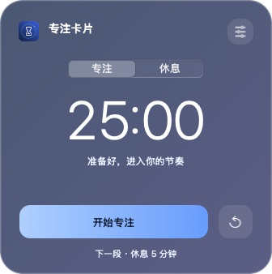
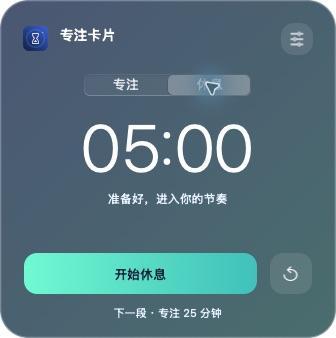
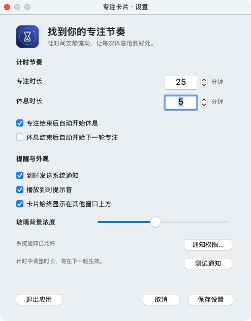

# 专注卡片 · FocusCard

[English](README.md) | [简体中文](README.zh-CN.md)

一个 macOS 计时应用，提供半透明卡片和菜单栏倒计时。
应用使用 Objective-C 与 AppKit。
应用界面使用简体中文。

<p align="center">
  
</p>

## 界面截图

以下图片来自 macOS 上实际运行的应用。
截图只包含应用窗口。

| 专注 | 休息 |
| --- | --- |
|  |  |

<details>
<summary>设置面板</summary>



</details>

## 功能

- 在菜单栏查看剩余时间。
- 分别设置专注和休息时长，范围为 1–180 分钟。
- 暂停、继续或重置当前计时。
- 设置专注与休息之间的自动切换。
- 在阶段结束时接收系统通知。
- 单独设置到时提示音。
- 调整半透明背景的浓度。
- 设置卡片是否置于其他窗口上方。
- 重新打开应用时恢复计时和卡片位置。

默认专注时长为 25 分钟。
默认休息时长为 5 分钟。
专注结束后，应用自动开始休息。
休息结束后，应用等待你开始下一轮专注。
两种自动切换行为都可以修改。
默认情况下，其他窗口可以覆盖卡片。

## 运行与构建条件

- 最低构建目标为 macOS 13。
- Xcode 命令行工具提供编译器。
- 构建脚本使用当前 Mac 的原生架构。
- 实测环境为 Apple Silicon 与 macOS 26.5.1。

应用没有外部运行依赖。
计时功能不需要网络连接。

## 构建

1. 如有需要，安装 Xcode 命令行工具。

   ```sh
   xcode-select --install
   ```

2. 克隆仓库。

   ```sh
   git clone https://github.com/hzxwonder/focus-card-macos.git
   ```

3. 进入仓库目录。

   ```sh
   cd focus-card-macos
   ```

4. 构建应用。

   ```sh
   bash scripts/build.sh
   ```

5. 打开应用。

   ```sh
   open build/FocusCard.app
   ```

构建脚本会生成应用包和图标。
构建脚本会运行计时检查。
构建脚本会为本机使用添加临时签名。
构建脚本不执行 Apple 公证。

## 使用

| 控件 | 操作 |
| --- | --- |
| 主按钮 | 开始、暂停或继续计时。 |
| 重置按钮 | 恢复当前阶段的完整时长。 |
| 专注或休息选择器 | 在准备或暂停状态下选择阶段。 |
| 卡片标题 | 拖动标题以移动卡片。 |
| 设置按钮 | 打开设置窗口。 |
| 菜单栏倒计时 | 打开计时菜单。 |
| 显示卡片 | 显示已隐藏的卡片。 |
| 隐藏卡片 | 隐藏卡片，计时继续。 |
| 空格键 | 卡片获得键盘焦点时，控制计时。 |
| Command-逗号 | 应用获得键盘焦点时，打开设置。 |
| Command-Q | 应用获得键盘焦点时，退出应用。 |

切换阶段后，应用使用该阶段的完整时长。
当前计时已经开始时，时长修改在下一阶段生效。
点击重置，可将修改后的时长用于当前阶段。
预览背景后点击取消，可恢复已保存的背景设置。

## 通知

1. 打开设置。
2. 勾选系统通知。
3. 保存设置。
4. 在 macOS 中允许通知。
5. 点击测试通知，检查通知是否送达。

设置窗口会显示通知权限状态。
权限被拒绝时，权限按钮会打开 macOS 设置。
macOS 专注模式可能阻止通知横幅出现。
提示音受 Mac 输出音量控制。

应用需要保持运行，才能在阶段结束时发送提醒。
隐藏卡片不会停止计时。
退出会停止应用进程。

## 计时行为

开始计时时，应用会保存结束时间。
暂停时，应用会保存剩余时间。
电脑休眠时间计入当前阶段。
电脑唤醒后，应用只处理一次已结束的阶段。
启用自动切换时，下一阶段从处理完成的时刻开始。
应用不会在休眠期间累计多个阶段。

重新打开应用时，应用会恢复已保存的阶段。
运行中的计时会沿用原结束时间。
本机偏好设置保存计时配置和卡片位置。
应用不会向服务器发送计时数据。

## 检查

构建脚本会自动运行检查。
也可以直接运行检查命令。

```sh
build/FocusCard.app/Contents/MacOS/FocusCard --self-test
```

检查覆盖剩余时间、暂停、继续、状态恢复、阶段切换、时长范围和倒计时格式。

以下命令读取本应用的通知权限和已送达通知。

```sh
build/FocusCard.app/Contents/MacOS/FocusCard --notification-status
```

## 文件结构

| 路径 | 内容 |
| --- | --- |
| `src/FocusCard.m` | 应用、计时逻辑、设置、通知和检查。 |
| `resources/Info.plist` | 应用包信息。 |
| `scripts/build.sh` | 本机构建脚本。 |
| `assets/icon.svg` | 可编辑沙漏图标。 |
| `assets/icon.png` | 1024 × 1024 像素图标。 |
| `docs/screenshots/` | 应用截图。 |
| `build/` | 本机构建输出。Git 不跟踪此目录。 |

## 文档写法

英文说明参考 ASD-STE100 写作原则。
英文说明使用短句、主动语态和一致术语。
中文说明采用对应结构。
本项目不声称符合完整的 ASD-STE100 词典要求，也不声称通过认证。
