# 专注卡片 · FocusCard

[English](README.md) | [简体中文](README.zh-CN.md)

专注卡片是一款 macOS 专注与休息计时器。
它显示一张半透明卡片，并在菜单栏显示倒计时。
应用使用 Objective-C 和 AppKit 编写。
界面支持简体中文和英文，默认跟随 macOS 的语言设置，也可在设置中指定。

<p align="center">
  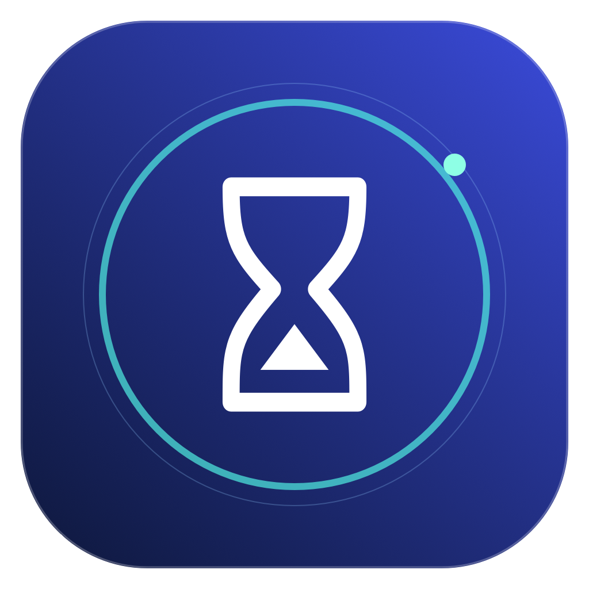
</p>

## 截图

参考图片由应用的原生视图渲染生成。
全屏提示图片使用示例桌面背景。

| 准备开始 | 专注中 | 已暂停 | 紧凑卡片 |
| --- | --- | --- | --- |
| 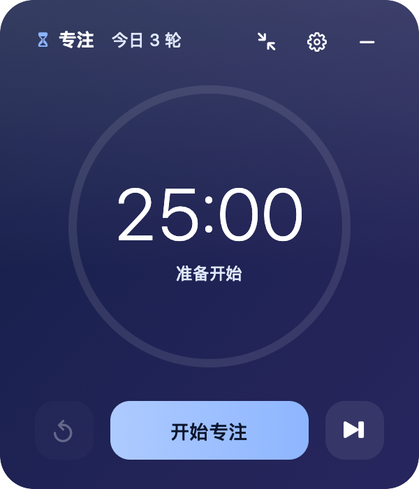 | 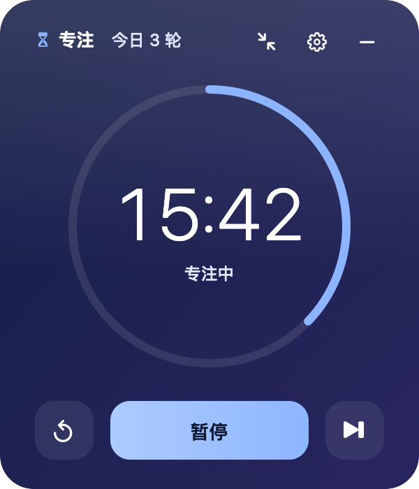 | 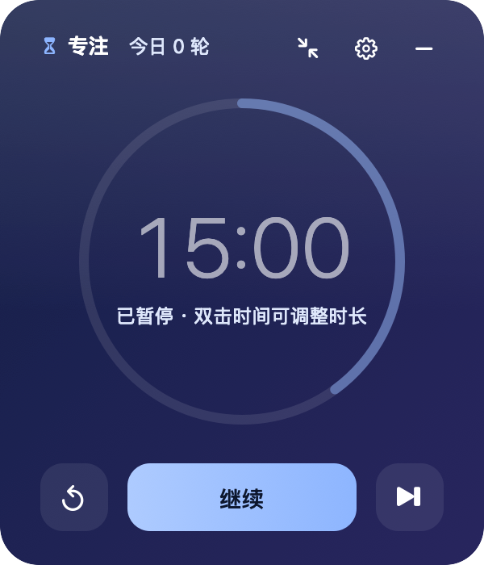 | 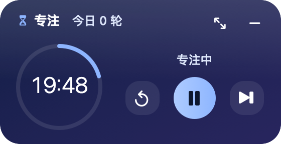 |


<details>
<summary>主题与设置</summary>

| 极光 | 霜玻璃 | 细雨 | 静水 | 暮光 | 石墨 |
| --- | --- | --- | --- | --- | --- |
| 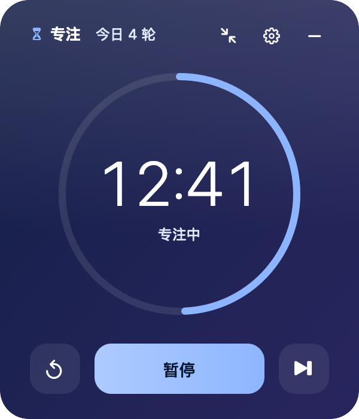 | 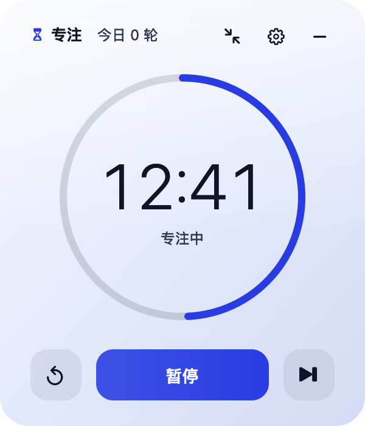 | 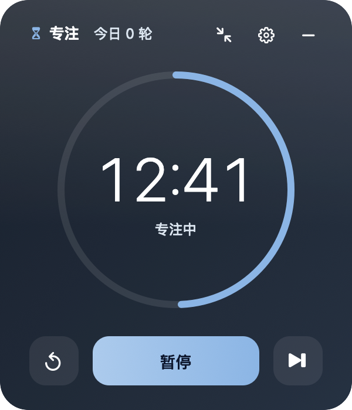 | 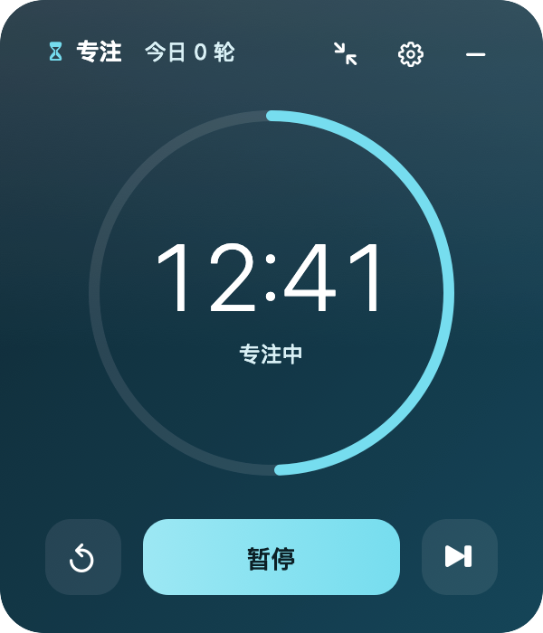 | 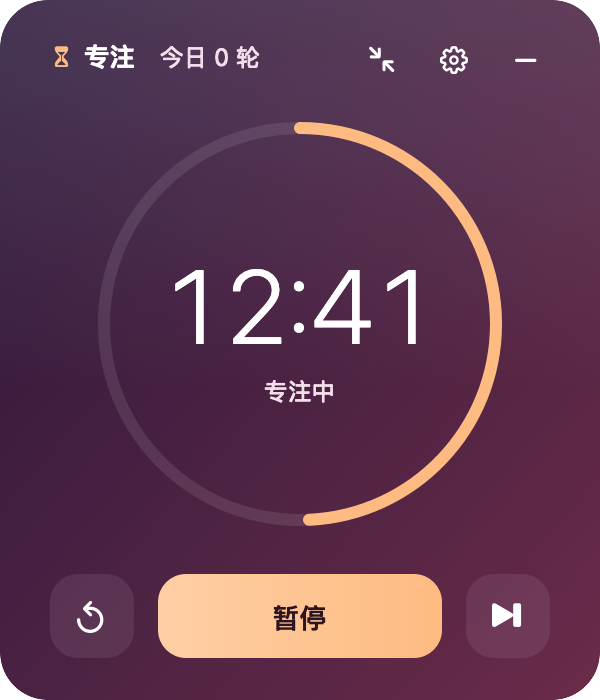 | 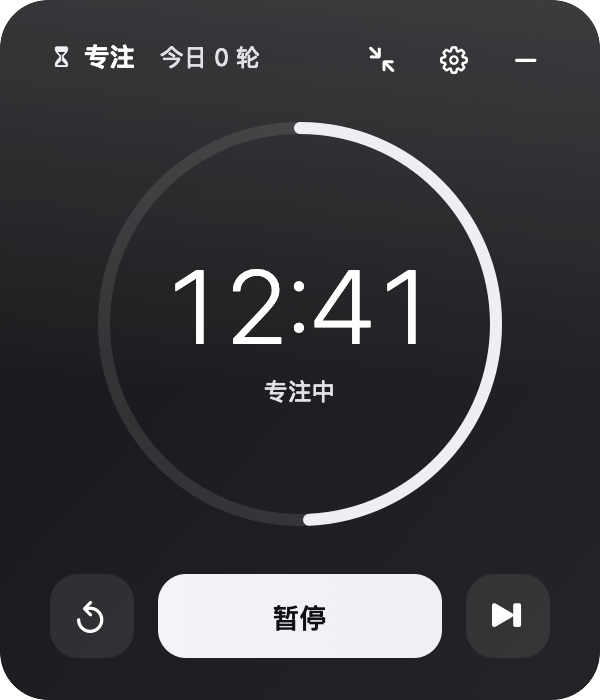 |

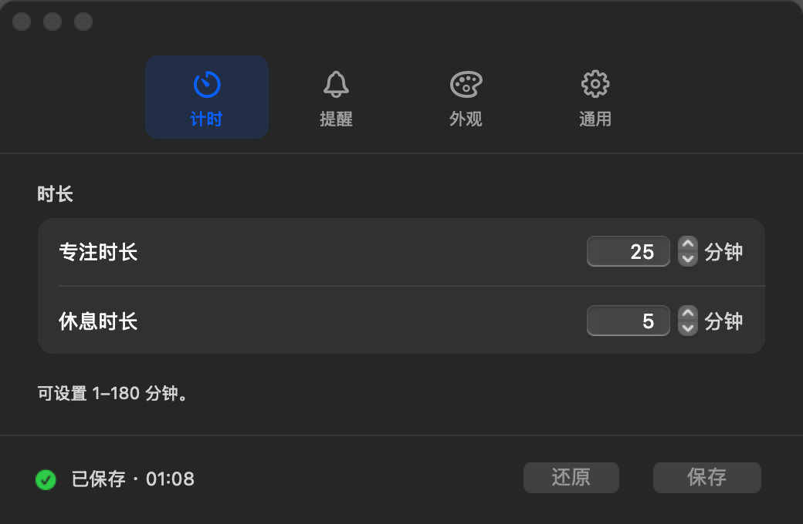

</details>

## 功能

- 进度环显示剩余时间。
- 一键切换标准卡片与紧凑卡片（280 × 144 pt，横向）。
- 在卡片、菜单栏或键盘上开始、暂停、继续、重新计时或跳过当前阶段。
- 专注与休息时长可设为 1–180 分钟。
- 阶段结束时，所有显示器上出现全屏磨砂提示（“该休息了” / “准备好专注了吗？”）。只有选择主按钮或按 Return，下一阶段才开始；按 Esc 或点击其他任意位置，可稍后再开始。
- 提示音可从七种 macOS 声音中选择，也可选择“无”，并可点按 ▶ 试听。
- 六种主题：极光、霜玻璃、细雨、静水、暮光、石墨。每种主题带有轻微的环境动效（缓慢的光线、细雨涟漪、水面涟漪或磨砂玻璃上的光泽），石墨无动效。
- 暂停时，双击时间即可调整时长。
- 界面语言可选：跟随系统、简体中文、English。
- 使用“仅系统通知”提示方式时，可选择专注与休息之间自动开始。
- 在阶段名称旁显示今天完成的专注轮数。
- 计时时在菜单栏显示剩余时间。
- 卡片可以显示在其他窗口上方，也可以放在普通应用窗口下方。
- 可调整卡片背景。
- 可在登录时自动打开。
- 再次打开应用时，恢复计时状态和卡片位置。

默认值：

| 设置 | 默认值 |
| --- | --- |
| 专注时长 | 25 分钟 |
| 休息时长 | 5 分钟 |
| 阶段结束时 | 全屏提示 |
| 提示音 | 玻璃 |
| 系统通知 | 开 |
| 主题 | 极光，环境动效开 |
| 语言 | 跟随系统 |
| 自动开始休息 / 专注（仅系统通知方式） | 开 / 关 |
| 显示在其他窗口上方 | 关 |
| 计时时在菜单栏显示剩余时间 | 开 |

## 要求

- macOS 13 或更高版本。
- 使用 Xcode Command Line Tools 编译。
- 按本机架构构建。

应用没有外部依赖，也不使用网络。

## 下载

[下载 3.1.2 版](https://github.com/hzxwonder/focus-card-macos/releases/tag/v3.1.2)。
选择 Apple Silicon（`arm64`）软件包。
解压后，将 `FocusCard.app` 移到“应用程序”目录。
打开应用。

发布包使用临时签名，不包含 Apple 公证。
发布包可公开下载。

## 构建

1. 如有需要，安装 Xcode Command Line Tools。

   ```sh
   xcode-select --install
   ```

2. 克隆仓库并进入目录。

   ```sh
   git clone https://github.com/hzxwonder/focus-card-macos.git
   cd focus-card-macos
   ```

3. 构建应用。

   ```sh
   bash scripts/build.sh
   ```

4. 打开应用。

   ```sh
   open build/FocusCard.app
   ```

构建脚本会编译应用、分别以中文和英文运行自检、生成图标并进行临时（ad hoc）签名。
任一测试失败时，构建会停止。
构建不会进行公证。若要在其他 Mac 上打开，请先公证，或在“系统设置 › 隐私与安全性”中允许。

## 使用

### 卡片

| 控件 | 作用 |
| --- | --- |
| 主按钮 | 开始、暂停或继续计时。 |
| 时间（暂停时） | 双击打开设置，并定位到当前阶段的时长。 |
| 重新计时（↺） | 恢复当前阶段的完整时长。计时开始后可用。 |
| 跳过（⏭） | 进入下一阶段。跳过的阶段不计入完成轮数。 |
| 设置（⚙） | 打开设置。 |
| 紧凑（↘↖） | 切换为紧凑卡片。紧凑卡片中的同一按钮（↖↘）可恢复标准卡片。 |
| 隐藏（–） | 隐藏卡片，计时继续。 |
| 卡片背景 | 拖动可移动卡片。 |

卡片顶部显示阶段和今天完成的专注轮数。
紧凑卡片为横向长条，显示阶段、今日轮数、带时间的进度环、状态，以及重新计时、开始/暂停和跳过按钮。
卡片为紧凑模式时，可从菜单栏或按 Command-逗号 打开设置。
再次打开应用时，卡片保持上次的模式。

### 菜单栏

专注时菜单栏显示沙漏，休息时显示茶杯。
计时进行时，菜单栏同时显示剩余时间；暂停时，暂停图标替代阶段图标。
应用中的所有图标统一使用 SF Symbols 和同一字重，与系统风格一致，并自动适配浅色和深色菜单栏。
点按图标可打开菜单。菜单显示当前状态、今日轮数、计时命令和“紧凑卡片”选项。

### 键盘

| 按键 | 作用 |
| --- | --- |
| 空格 | 卡片处于活跃状态时，开始或暂停计时。 |
| Command-R | 重新计时。 |
| Command-右箭头 | 跳到下一阶段。 |
| Command-W | 隐藏卡片，或关闭设置。 |
| Command-逗号 | 打开设置。 |
| Command-Q | 退出应用。 |
| Return（全屏提示） | 开始下一阶段。 |
| Esc 或点击按钮以外的位置（全屏提示） | 关闭提示，下一阶段保持就绪。 |

### 设置

设置分为四个面板：计时、提醒、外观、通用。
更改先作为草稿，选择“保存”（或按 Return）后才生效。

- 底部状态栏显示：所有设置已保存、未保存的更改数量，或“已保存 · 时间”。
- 主题、背景和环境动效在保存前即可在卡片上预览。
- “还原”放弃草稿。关闭有未保存更改的设置窗口时，会询问：保存、不保存或取消。
- 计时未开始时，新时长应用到当前阶段。
- 计时已暂停时，新时长应用到当前阶段，已用时间保留。如果新时长短于已用时间，时间显示 00:00，选择“继续”即完成该阶段。
- 计时进行中时，新时长从下一阶段生效。
- 如果输入的不是 1–180 之间的整数，“保存”不可用，并显示红色提示。支持全角数字。
- “恢复默认设置”把默认值放入草稿，保存后生效，不影响当前计时和今日轮数。
- 新语言在应用重新打开后生效。选择“立即重新打开”即可，计时不中断。

关闭“显示在其他窗口上方”后，普通应用窗口始终位于卡片上方。
显示卡片时保留当前应用焦点。卡片被覆盖时，可通过“显示桌面”访问；如需工作时持续可见，可开启此选项。

## 通知

1. 开始一次计时，或在设置中选择“允许通知…”。
2. macOS 询问时，选择允许。
3. 在设置中选择“发送测试通知”检查效果。

如果 macOS 已关闭本应用的通知，设置中的按钮会打开 macOS 通知设置。
macOS 的专注模式可能会隐藏通知横幅。
提示音使用 Mac 的输出音量。

## 计时规则

- 开始计时时，应用保存结束时间。
- 暂停时，应用保存剩余时间。
- 睡眠时间计入当前阶段。
- 如果阶段在 Mac 睡眠或应用关闭时结束，应用只完成该阶段一次。若阶段已结束超过一分钟，应用不播放提醒，也不自动开始下一阶段，卡片会显示结束时间。
- 如果系统时间被调早，剩余时间不会超过阶段时长。
- 今日轮数在午夜重新计算。

## 隐私

- 所有数据只保存在本机的偏好设置中（`defaults read local.focuscard.desktop`）。
- 应用不向任何服务器发送数据，也不使用统计分析。
- 应用只保存计时状态、设置、今日轮数和卡片位置。
- 通知只包含阶段名称和时长。
- 卡片隐藏或被遮挡、或 macOS 开启“减少动态效果”时，环境动效停止。

## 测试

在 macOS 中运行完整测试命令：

```sh
bash scripts/test.sh
```

命令会构建应用、渲染参考图片，并运行中英文各 185 项自检。
随后会运行中英文实时 UI 测试。
UI 测试使用独立的应用标识和偏好设置域。
测试会在当前桌面打开窗口和提示界面。
JSON 结果与日志位于 `build/test-results/`。
受自动化环境限制的检查不计为通过。

本次共通过 493 项检查，没有失败项；五项记录需要人工复核窗口拖动或前台键盘焦点。
具体结果、性能测量和测试范围见[验证报告](docs/TESTING.zh-CN.md)。

也可以直接运行自检：

```sh
FOCUSCARD_LANG=zh build/FocusCard.app/Contents/MacOS/FocusCard --self-test
FOCUSCARD_LANG=en build/FocusCard.app/Contents/MacOS/FocusCard --self-test
```

其他命令：

```sh
# 从原生视图渲染参考图片
build/FocusCard.app/Contents/MacOS/FocusCard --render-screenshots /tmp/focuscard-shots
# 查看通知权限和已送达的通知
build/FocusCard.app/Contents/MacOS/FocusCard --notification-status
```

## 打包

请先提交源码更改，再创建发布包。

```sh
bash scripts/package.sh
```

脚本会构建应用，并在 `build/release/` 中创建压缩包。
脚本会解压发布包，检查签名和可执行文件是否一致。
脚本还会对解压后的应用运行中英文自检，并生成构建信息与 SHA-256 校验文件。

## 文件

| 路径 | 内容 |
| --- | --- |
| `src/FocusCard.m` | 应用、计时模型、设置、通知、自检和截图渲染。 |
| `resources/Info.plist` | 应用包信息。 |
| `scripts/build.sh` | 构建脚本。使用 `--screenshots` 将图片渲染到 `build/screenshots`。 |
| `scripts/test.sh` | 中英文隔离 UI 测试。 |
| `scripts/package.sh` | 发布包生成与完整性检查。 |
| `assets/icon.svg` | 可编辑的沙漏图标。 |
| `assets/icon.png` | 1024 × 1024 像素图标。 |
| `docs/screenshots/` | 应用截图。 |
| `build/` | 本地构建输出，Git 会忽略此目录。 |

## 许可证

本项目基于 [MIT License](LICENSE) 开源。
